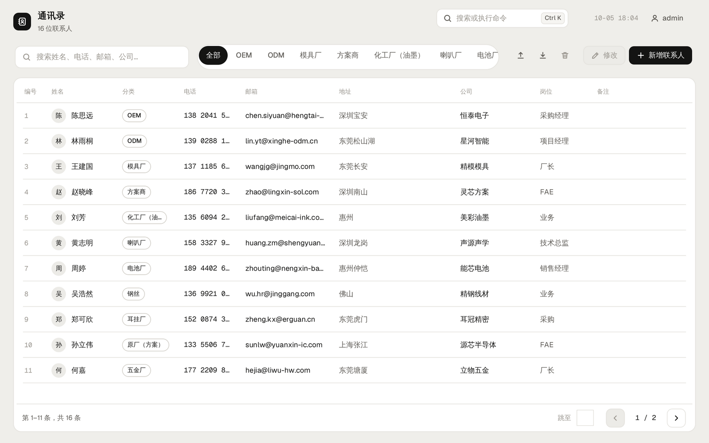
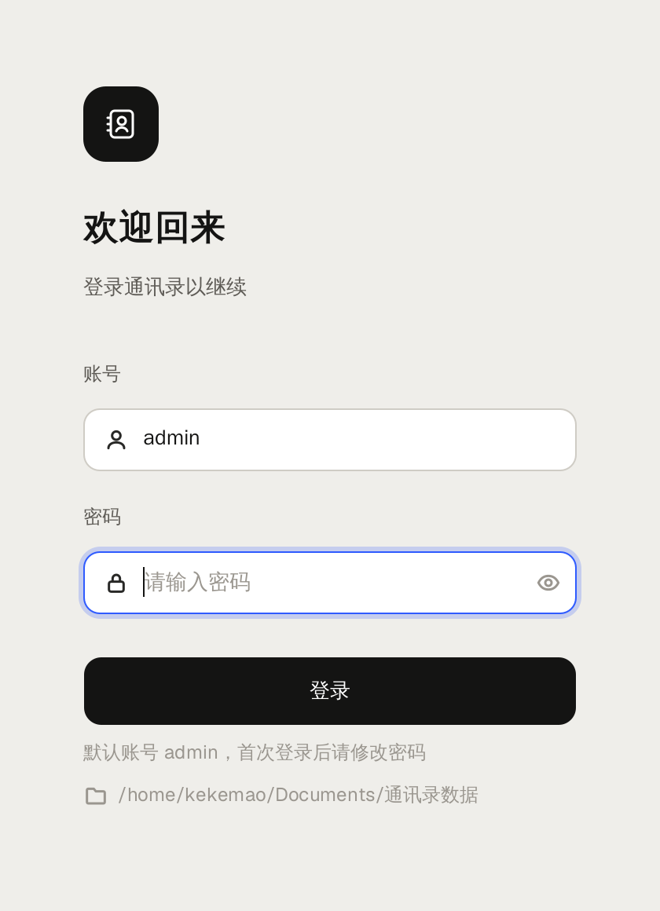
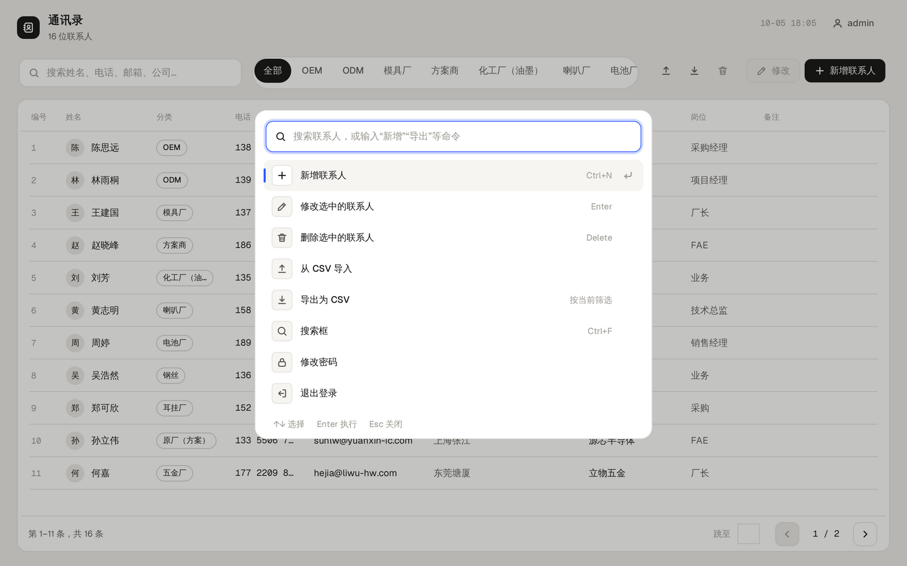
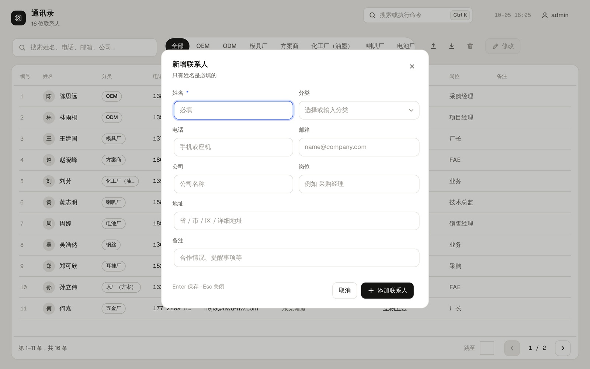
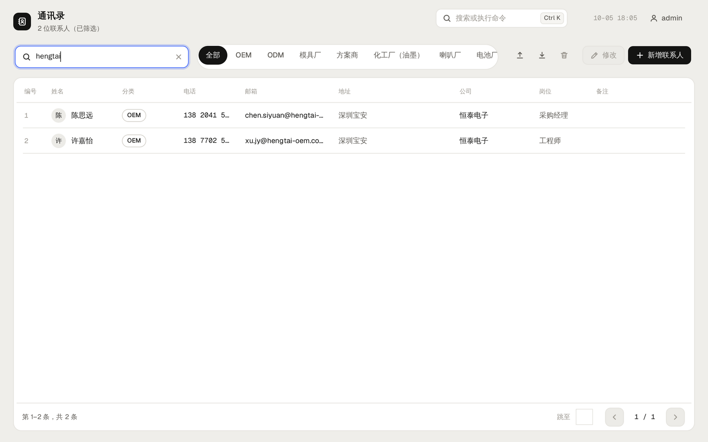
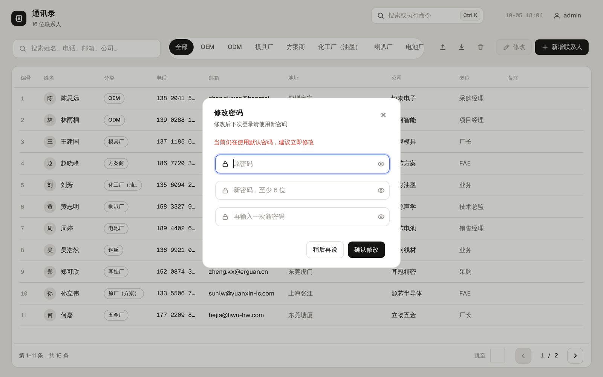
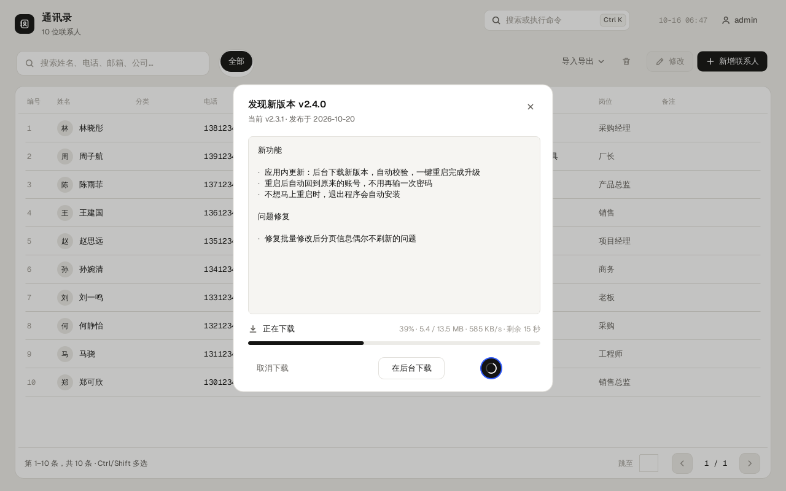
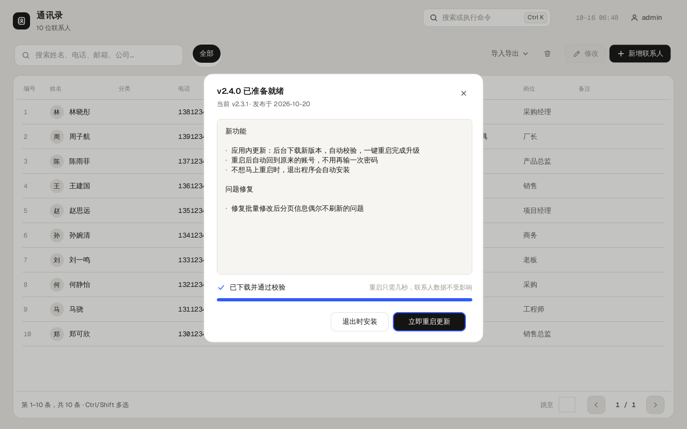

# 📒 ContactManager — 通讯录管理系统

[](https://openjdk.org/)
[](https://docs.oracle.com/javase/tutorial/uiswing/)
[](https://www.sqlite.org/)
[](LICENSE)
[](https://github.com/kekemao00/contact-manager-swing/releases)
[](https://github.com/kekemao00/contact-manager-swing/releases/latest)
[](https://github.com/kekemao00/contact-manager-swing/actions/workflows/ci.yml)

一个**纯本地**的 Java Swing 通讯录：联系人按行业分类管理、全局搜索、CSV 导入导出、自动备份，数据只存在你自己的电脑上。

<p align="center">
  
</p>

---

## 🍺 这个项目是怎么来的

某个普通的工作日饭局，同事抱怨说市面上的通讯录工具要么太重、要么数据存云端不放心、要么分类功能完全对不上他的使用场景。

酒过三巡，我随口说了一句：

> **"这有啥难的，我给你做一个。"**

第二天早上酒醒，打开电脑，兑现承诺。

花了大约 2 小时，从零撸出了这个工具。
他用了之后说：*"比我买的那个好用多了。"*

既然做都做了，顺手开源出来——万一还有别的同事也在喝酒吹牛呢。

---

## ✨ 功能特性

| 功能 | 说明 |
|------|------|
| 📋 **联系人管理** | 新增、编辑、删除、查看，字段覆盖姓名、公司、电话、邮箱、备注等 |
| ✏️ **批量修改** | `Ctrl` / `Shift` 多选联系人（或直接按当前筛选结果），勾选地址、公司、分类、岗位、备注中要改的字段，一次改成同一个值；供应商搬家不用再一个个改 |
| 🏷️ **行业分类筛选** | 内置 OEM、ODM、模具厂、方案商等分类，支持自定义扩展 |
| 🔍 **全局模糊搜索** | 实时过滤，输入即搜，支持姓名、公司、电话、邮箱等多字段匹配 |
| 📤 **CSV 导入导出** | 方便批量导入历史数据，随时备份导出 |
| 💾 **自动备份** | 每次启动自动备份，保留最近 5 份，存储在用户文档目录 |
| ☁️ **一键云端备份** | 自动发现电脑上的 OneDrive、iCloud 云盘、坚果云、Dropbox、Google 云端硬盘，点一下开启；改动后自动把快照存进网盘，由网盘客户端上传。换电脑时发现备份会提示一键恢复 |
| 🔐 **更安全的登录** | 密码以加盐 PBKDF2 哈希存储（旧版明文密码首次登录时自动升级）；连续输错 5 次锁定 30 秒；支持修改密码、退出登录，忘记密码可用 `--reset-password` 重置 |
| 🎨 **重做的界面** | 暖灰底、黑白组件、Geist 字体，只在主操作和选中 / 聚焦状态上使用一个蓝色强调色；新增、编辑、确认都在窗口内以面板展开，不再弹对话框 |
| ⌨️ **命令面板与快捷键** | `Ctrl/⌘ + K` 打开命令面板，搜联系人或执行任何操作；常用操作都有快捷键 |
| 🔄 **应用内更新** | 新版本在后台下载并校验，准备好后点一下“立即重启更新”，几秒后回到原来的界面，不用重新登录；不想马上重启的话，退出程序时自动安装。联系人数据不受影响 |
| 📦 **绿色免安装** | 内嵌 JRE，打包为 Windows 绿色版，解压即用，无需安装 Java 环境 |

---

## 📸 截图

> 以下截图均为当前版本实际运行截取，数据为演示用的虚构联系人。

### 登录

<p align="center"></p>

### 主界面：分类标签与联系人列表


### 命令面板（`Ctrl/⌘ + K`）



### 新增 / 编辑联系人



### 全局搜索



### 修改密码（使用默认密码登录时自动提示）



---

## ⌨️ 快捷键

| 快捷键 | 作用 |
|--------|------|
| `Ctrl/⌘ + K` | 打开命令面板（搜联系人、新增、导入导出、修改密码、退出登录……） |
| `Ctrl/⌘ + N` | 新增联系人 |
| `Ctrl/⌘ + F` | 聚焦搜索框 |
| `Enter` | 编辑选中的联系人；在面板中为保存 |
| `Ctrl` / `Shift` + 点击 | 多选联系人，选中多位后“修改”按钮变为批量修改 |
| `Ctrl/⌘ + A`（表格内） | 全选本页联系人 |
| `Delete` | 删除选中的联系人（会先确认，支持多选） |
| `Esc` | 关闭面板 / 清空搜索 |
| `PageUp` / `PageDown` | 上一页 / 下一页 |

---

## 🚀 快速开始

### 方式一：直接使用（推荐，无需安装 Java）

1. 前往 [Releases](https://github.com/kekemao00/contact-manager-swing/releases) 下载最新的 `ContactManager-<版本>-windows-x64.zip`
2. 解压到任意目录
3. 双击 `ContactManager.exe` 运行（已内嵌 JRE）
4. 使用默认账号登录：

```
账号：admin
密码：123456
```

> ⚠️ 首次登录后建议修改默认密码，毕竟 `123456` 这种密码连我同事都能猜到。使用默认密码登录时会自动弹出修改提示，之后也可以点右上角的账号菜单，或在命令面板里选「修改密码」。

#### 忘记密码

带上 `--reset-password` 参数启动一次，即可把 `admin` 的密码重置为默认密码 `123456`（只改密码，联系人数据不受影响）：

```bash
# jar 版本
java -jar contact-manager-swing-<版本>.jar --reset-password

# Windows 绿色版（在解压目录中打开命令行）
ContactManager.exe --reset-password
```

> 连续输错 5 次密码会锁定 30 秒，等一会儿再试即可。

已安装 Java 21+ 的用户，也可以下载 `contact-manager-swing-<版本>.jar`，直接运行：

```bash
java -jar contact-manager-swing-<版本>.jar
```

---

### 方式二：从源码编译（需要 JDK 21+ 和 Maven）

```bash
# 克隆项目
git clone https://github.com/kekemao00/contact-manager-swing.git
cd contact-manager-swing

# 编译打包（依赖由 Maven 自动下载，产物为包含全部依赖的单文件 jar）
mvn package

# 运行
java -jar target/contact-manager-swing.jar
```

---

## 🤖 自动化构建与发布

项目使用 GitHub Actions：

- **CI**（`.github/workflows/ci.yml`）：推送到 `main` 或提交 PR 时自动编译、测试，并上传可运行 jar 作为构建产物。
- **Release Please**（`.github/workflows/release-please.yml`）：合并到 `main` 的改动会自动累积到一个**发版 PR** 里，PR 中包含按提交信息推算的新版本号和 `CHANGELOG.md`。**合并这个发版 PR 即发布**：自动打标签、创建 GitHub Release 并上传：
  - `contact-manager-swing-<版本>.jar`：跨平台可运行 jar（需 Java 21+）
  - `ContactManager-<版本>-windows-x64.zip`：内嵌 JRE 的 Windows 绿色版

版本号按 [Conventional Commits](https://www.conventionalcommits.org/zh-hans/) 推算：

| 提交信息 | 版本变化 |
|------|------|
| `fix: …` | 修订号 +1（2.0.0 → 2.0.1） |
| `feat: …` | 次版本号 +1（2.0.0 → 2.1.0） |
| `feat!: …` 或正文含 `BREAKING CHANGE:` | 主版本号 +1（2.0.0 → 3.0.0） |
| `docs:` / `ci:` / `chore:` 等 | 不单独触发发版 |

> 首次使用需在仓库 **Settings → Actions → General** 勾选 *Allow GitHub Actions to create and approve pull requests*，否则 Release Please 无法创建发版 PR。

也可以跳过发版 PR 手动发布（`.github/workflows/release.yml`）：推送 `v*` 标签，或打开 [Actions → Release](https://github.com/kekemao00/contact-manager-swing/actions/workflows/release.yml) 点 **Run workflow** 填入版本号。版本号带 `-`（如 `2.1.0-beta.1`）时会发布为预发布版本。

## 🔄 应用内更新

打包发布的版本启动后会在后台检查 GitHub 上的最新正式版本（每天最多一次，网络不通时不打扰）。发现新版本时：

1. **后台下载**：不弹窗、不打断，直接在后台下载新版本（约 14 MB），网络中断后从断点继续。
2. **自动校验**：核对文件大小、GitHub 提供的 SHA-256、版本号以及所需的 Java 版本，任何一项不对都丢弃，不会装上来路不明或损坏的文件。
3. **一键重启**：顶部提示“已就绪”，点开后选 **立即重启更新**。新版本启动并自动回到当前账号后旧窗口才关闭，中间不会出现空白，也不用重新输密码。
4. **退出时安装**：不想马上重启，就选 **退出时安装**，下次打开就是新版本。
5. **更新完成**：新版本第一次打开时提示“已更新到 vX.Y.Z”，点开可以看这次更新了什么。

<p align="center"> </p>

更新只替换程序本身，联系人数据在“文档/通讯录数据”里，不会被动到。绿色版会保留上一版的启动配置（`ContactManager.cfg.bak`），旧版本文件等新版本成功启动后才删除。从源码运行、程序所在文件夹没有写入权限、或新版本需要更高的 Java 时，面板会改为提供 **前往下载页**。

也可以随时在右上角账号菜单或命令面板（`Ctrl/⌘ + K`）里选择 **检查更新**；账号菜单里可以关闭 **自动下载更新**，更新面板里可以 **跳过此版本**。检查和下载只读取公开的版本信息和安装文件，不会上传任何数据。下载的文件暂存在系统缓存目录（Windows 为 `%LOCALAPPDATA%\ContactManager\updates`），不会放进会被网盘同步的“文档”。

---

## 🛠️ 技术栈

| 技术 | 版本 | 用途 |
|------|------|------|
| Java | 21 | 运行环境 |
| Java Swing | — | 桌面 GUI 框架 |
| SQLite | 3.45.2 | 本地数据存储 |
| sqlite-jdbc | 3.45.2.0 | SQLite Java 驱动 |
| SLF4J | 2.0.9 | 日志门面 |
| Maven | 3.9+ | 构建与依赖管理 |
| jpackage | 21 | 打包内嵌 JRE 的 Windows 绿色版 |

---

## 📁 项目结构

```
ContactManager/
├── src/me/kekemao/
│   ├── Main.java               # 程序入口
│   ├── LoginGUI.java           # 登录界面
│   ├── AccountService.java     # 账号逻辑（密码哈希、登录锁定、修改密码）
│   ├── ChangePasswordSheet.java # 修改密码面板
│   ├── ContactWindow.java      # 联系人主界面（列表、搜索、分类标签）
│   ├── ContactEditSheet.java   # 新增 / 编辑联系人面板
│   ├── BatchEditSheet.java     # 批量修改面板
│   ├── CommandPalette.java     # Ctrl/⌘ + K 命令面板
│   ├── CloudBackup.java        # 云端备份（写快照到网盘同步文件夹、恢复）
│   ├── UpdateChecker.java      # 检查更新（GitHub Releases）与更新流程
│   ├── Updater.java            # 应用内更新：下载、校验、替换并重启
│   ├── UpdateSheet.java        # 更新面板（下载进度、立即重启）
│   ├── Theme.java              # 全局主题入口、提示与确认
│   ├── Utils.java              # 数据库操作、导入导出、备份等工具类
│   └── ui/                     # 颜色、字体、弹簧动画与通用组件
├── resources/fonts/            # Geist 字体（SIL OFL 1.1）
├── images/                     # README 截图
├── .github/workflows/          # CI 与自动发布
├── pom.xml                     # Maven 构建配置
└── .gitignore
```

---

## 📄 数据存储

所有数据默认完全本地存储（唯一的联网是检查与下载更新，只读取公开的版本信息和安装文件）：

```
~/Documents/通讯录数据/
├── txl.db          # 主数据库
└── backup/         # 自动备份目录（保留最近 5 份）
```

每次启动时自动执行备份。你的联系人数据只属于你，程序本身不会把它发到任何服务器上。

### 云端备份（可选）

在右上角「账号」菜单或命令面板里开启。程序会自动找到电脑上已有的网盘同步文件夹，把数据库快照写进其中的 `通讯录备份/` 文件夹，上传由你自己的网盘客户端完成，不需要注册账号或填写地址：

- 只写完整一致的快照，从不让网盘同步正在使用的 `txl.db`；
- 改动后约 20 秒自动备份一次，退出程序前也会补上；
- 快照文件名带有电脑名，每台电脑各保留最近 10 份，多台电脑共用一个网盘互不影响；
- 在新电脑上首次打开时，如果网盘里已有备份，会提示一键恢复；恢复前本机数据会另存到 `backup/`。

没有被自动发现的网盘，可以用「备份到其他文件夹…」手动选择同步文件夹。

---

## 📦 依赖

依赖统一在 `pom.xml` 中声明，由 Maven 自动下载：

```
org.xerial:sqlite-jdbc:3.45.2.0
org.slf4j:slf4j-api:2.0.9
org.slf4j:slf4j-nop:2.0.9
```

---

## 🗺️ 后续计划

> 如果下次饭局再喝多了，可能会加上这些：

- [ ] 支持多用户账号管理
- [ ] 支持联系人标签（Tag）功能
- [ ] 支持导出为 vCard (.vcf) 格式
- [ ] 支持深色模式
- [ ] 支持 macOS / Linux 安装包（目前可直接运行 jar）
- [ ] 支持联系人头像

欢迎提 Issue，但请不要在饭局上当面催我。

---

## 📜 License

[MIT](LICENSE) © [kekemao00](https://github.com/kekemao00)

> 开源协议选 MIT，因为我同事说他也想改改拿去用。随便，反正 2 小时做的。
